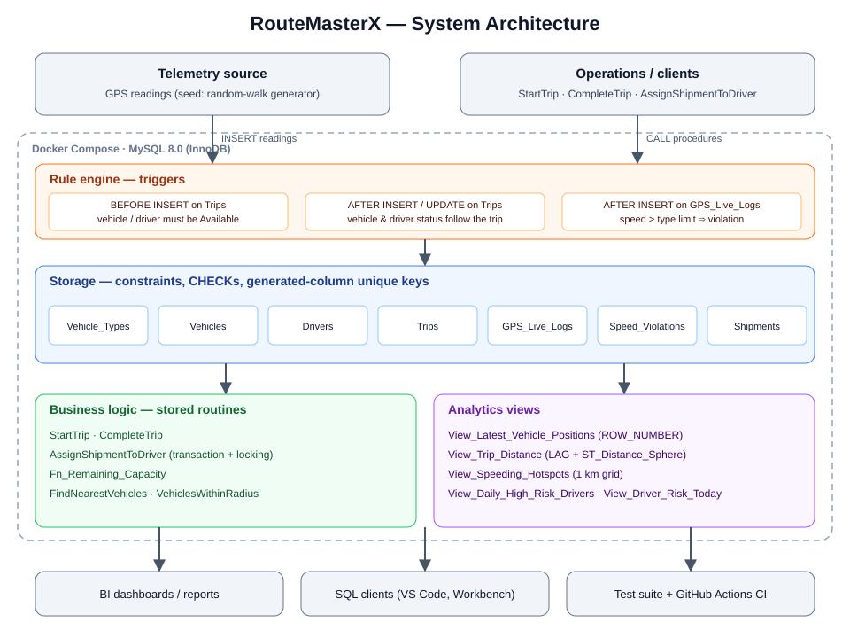
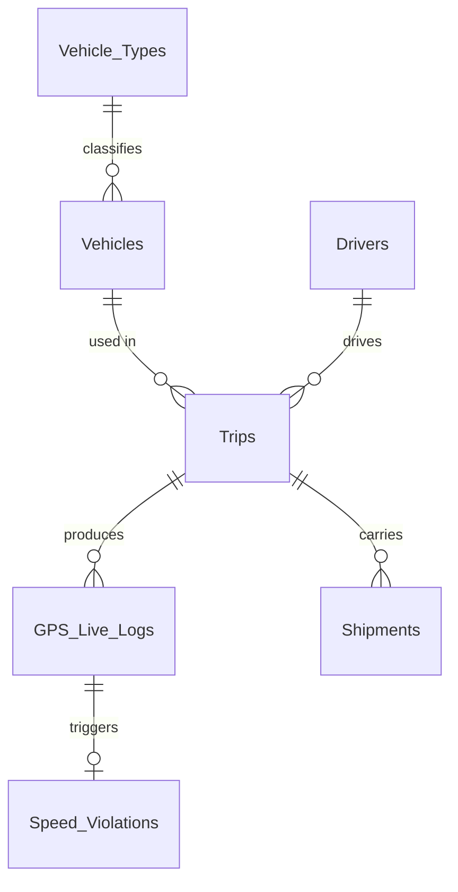
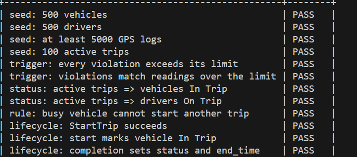
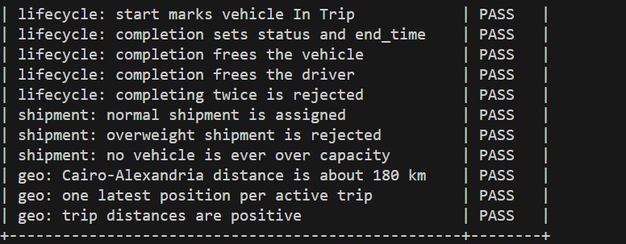
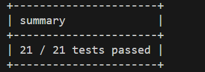
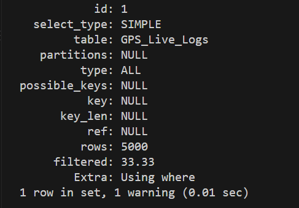
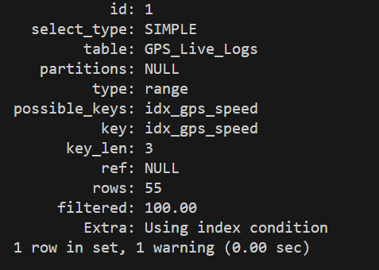
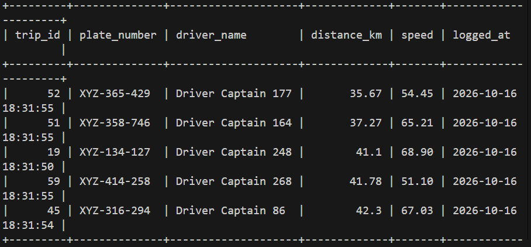
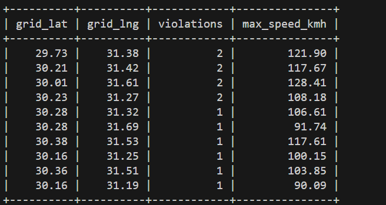

# 🚚 RouteMasterX — Fleet Management & Logistics Database

[](https://github.com/Hisham11Computer/fleet-management-db/actions)

A MySQL 8 database for a logistics company: fleet, drivers, trips, live GPS telemetry, speed-violation detection, shipment assignment and geospatial analytics. Business rules are enforced **inside the database** (constraints, triggers, transactions) and verified by an automated test suite and CI.

## Highlights

- **Integrity by design** — one active trip per vehicle/driver (generated-column unique keys), `CHECK` constraints, status automation via triggers.
- **Automatic speed-violation detection** — per-vehicle-type limits stored as data.
- **Geospatial analytics** — nearest vehicles, geofence radius search, trip distance (`LAG` + `ST_Distance_Sphere`), speeding hotspots.
- **Transactional shipment assignment** — best-fit by remaining capacity, row locking and re-check.
- **Trip lifecycle** — `StartTrip` → `CompleteTrip` (frees resources, marks shipments Delivered).
- **Indexing benchmark** — `EXPLAIN` before/after, plus composite indexes for real access patterns.
- **One-command setup** (Docker), **self-checking tests**, **GitHub Actions CI**.

## Architecture



Telemetry and client calls enter the database; **triggers** enforce the rules, **InnoDB tables** keep the data consistent, **stored routines** hold the business logic and **views** expose analytics. Everything runs in one Docker container and is verified by the test suite and CI. Design decisions and trade-offs: [docs/ARCHITECTURE.md](docs/ARCHITECTURE.md).

## ER diagram



## Quick start

### Option A — Docker (recommended)
```bash
git clone https://github.com/YOUR_USERNAME/fleet-management-db.git
cd fleet-management-db
docker compose up -d
docker compose logs -f db        # wait for "ready for connections" (seeding takes a moment)
docker compose exec db mysql -uroot -p RouteMasterX     # password: root (see .env.example)
```

### Option B — local MySQL 8.0.16+
```bash
mysql -u root -p
```
```sql
SOURCE run_all.sql;
```

## Try it

```sql
-- 5 vehicles closest to Tahrir Square
CALL FindNearestVehicles(30.0444, 31.2357, 5);

-- everything inside 10 km of a point
CALL VehiclesWithinRadius(30.0444, 31.2357, 10);

-- assign a shipment to the best-fitting trip
CALL AssignShipmentToDriver(1, @msg);  SELECT @msg;

-- start and finish a trip
CALL StartTrip(450, 450, @trip);  CALL CompleteTrip(@trip);

-- analytics
SELECT * FROM View_Driver_Risk_Today ORDER BY violations_today DESC LIMIT 10;
SELECT * FROM View_Speeding_Hotspots ORDER BY violations DESC LIMIT 10;
SELECT * FROM View_Trip_Distance ORDER BY distance_km DESC LIMIT 10;
```

## Tests
```bash
docker compose exec db mysql -uroot -p -e "SOURCE /tests/test_suite.sql"
```
Every line should say `PASS`. The same suite runs in CI on every push.

## Performance benchmark

```sql
EXPLAIN SELECT * FROM GPS_Live_Logs WHERE speed >= 120.00;   -- before: type=ALL
CREATE INDEX idx_gps_speed ON GPS_Live_Logs (speed);
EXPLAIN SELECT * FROM GPS_Live_Logs WHERE speed >= 120.00;   -- after: type=range
```
To benchmark on ~500k rows, run `sql/optional/seed_large.sql`. Add your own `EXPLAIN` screenshots to `docs/`.

## Screenshots

**Test suite — all checks pass**





**Indexing benchmark** — full table scan before, index range scan after

| Before (`type = ALL`) | After (`type = range`) |
|---|---|
|  |  |

**Geospatial queries**





## Project structure
```
fleet-management-db/
├── docker-compose.yml
├── run_all.sql
├── sql/
│   ├── 00_reset.sql            drop database (re-runnable)
│   ├── 01_schema.sql           tables + constraints
│   ├── 02_triggers.sql         business rules
│   ├── 03_seed.sql             synthetic data (GPS random walk)
│   ├── 04_indexes_views.sql    benchmark, indexes, reporting views
│   ├── 05_procedures.sql       trip lifecycle + shipment assignment
│   ├── 06_geo_queries.sql      geospatial views and procedures
│   └── optional/               large seed, spatial index
├── tests/test_suite.sql
├── docs/
│   ├── ARCHITECTURE.md         design decisions, trade-offs, scaling path
│   └── images/                 architecture diagram + screenshots
└── .github/workflows/ci.yml
```

## Documentation
See [docs/ARCHITECTURE.md](docs/ARCHITECTURE.md) for design decisions, concurrency notes and the scaling path.

## License
MIT
